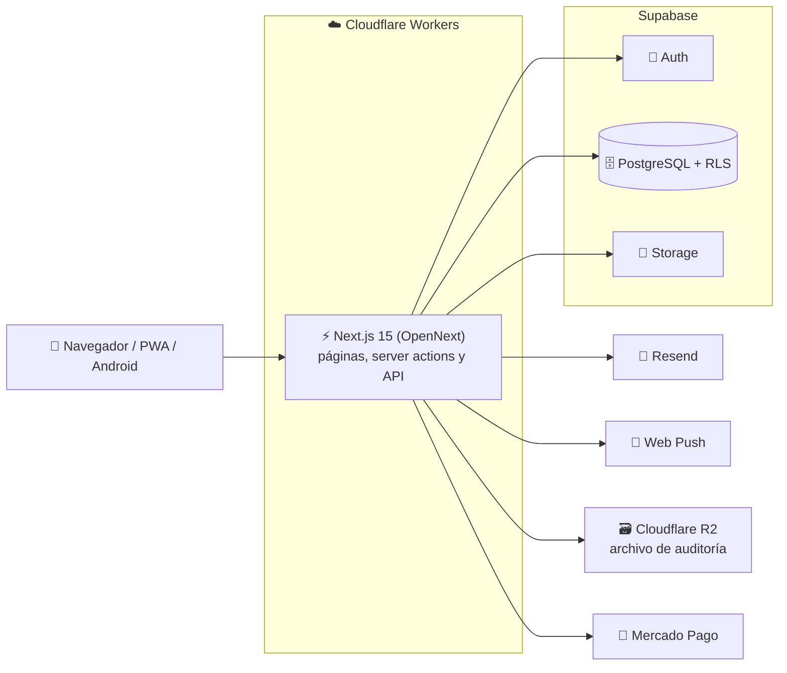

# 🧉 Reporty

**Plataforma ciudadana independiente para reportar problemas urbanos en Posadas**

🔗 **[reporty.com.ar](https://reporty.com.ar/)**

---

## 📋 Descripción

Reporty es una plataforma web creada **por vecinos, para vecinos**. Permite a los ciudadanos de Posadas reportar problemas urbanos (baches, luminarias rotas, basura, agua, etc.), verlos en un mapa y seguir su resolución. Sin intermediarios políticos, con total transparencia.

### ✨ Características

- 🗺️ **Mapa interactivo** con agrupación de reportes cercanos.
- 📝 **Reportes con fotos**, categoría, prioridad y dirección. Antes de crear uno, avisa si ya existe un reporte parecido en la zona.
- 🛡️ **Moderación de imágenes**: toda foto se revisa antes de publicarse.
- 💬 **Actualizaciones de la comunidad** en cada reporte y voto «No existe» para depurar reportes falsos.
- 🔧 **Reparaciones verificadas**: cualquier vecino informa el arreglo con una foto y la comunidad lo confirma. El autor del reporte puede cerrarlo él mismo con su foto.
- 🐾 **Mascotas perdidas**: publicación y búsqueda en el mapa.
- 🏆 **Puntos y ranking** de la comunidad.
- 📊 **Dashboard** con mapa de calor, gráficos y zonas con más reportes.
- 🔔 **Notificaciones** por email y push (web, PWA y app Android).
- 💚 **Donaciones** con Mercado Pago.
- 🧰 **Panel de administración**: moderación, reportes, usuarios, métricas, operaciones y auditoría.
- 🔐 **Cuentas** con email y contraseña, y modo invitado para empezar sin registrarse.
- 📱 **Mobile first**, con modo oscuro.

---

## 🏗️ Arquitectura

- Las mutaciones importantes (votos, reparaciones, puntos, moderación) son **RPC transaccionales en PostgreSQL**: la base de datos decide, la interfaz solo muestra.
- El servidor valida la sesión con Supabase Auth y ejecuta las escrituras con un cliente de servicio que nunca llega al navegador.
- Los formularios públicos están protegidos con **Cloudflare Turnstile**.

---

## 🔐 Roles

| Rol | Qué puede hacer |
|-----|-----------------|
| **Admin** | Todo: moderar, cambiar estados, gestionar usuarios y ver analytics y auditoría |
| **Ciudadano** | Crear reportes y mascotas, comentar, votar e informar reparaciones |
| **Interesado** | Ver el mapa y los reportes, y acceder al dashboard de analytics |
| **Operador** | Operador municipal: gestiona los reportes desde el panel de operaciones |
| **Invitado** | Sesión anónima: puede crear reportes sin registrarse; al registrarse pasa a ser una cuenta completa |

---

## 🎮 Sistema de puntos

| Acción | Puntos |
|--------|:------:|
| Crear un reporte | +10 |
| Publicar una mascota perdida | +10 |
| Comentar en un reporte ajeno | +2 |
| Votar «No existe» | +1 |
| Tu reporte queda Reparado por verificación de la comunidad o de administración | +5 |
| Tu reporte es rechazado | −3 |
| Eliminar tu propio reporte | −10 |
| Administración revierte una reparación validada | −5 |

Cerrar tu propio reporte como Reparado no suma puntos.

---

## 📦 Tecnologías

| Categoría | Tecnologías |
|-----------|-------------|
| **Frontend** | Next.js 15 (App Router), React 19, TypeScript, Tailwind CSS 4 |
| **UI** | shadcn/ui, Radix UI, Lucide Icons, Sonner, next-themes |
| **Mapas y gráficos** | Leaflet, React Leaflet, Marker Cluster, Recharts |
| **Formularios** | React Hook Form, Zod |
| **Backend** | Supabase (PostgreSQL con RLS, Auth, Storage) |
| **Infraestructura** | Cloudflare Workers (OpenNext), Cloudflare R2, Cloudflare Turnstile |
| **Servicios** | Resend (email), Web Push, Mercado Pago |
| **Pruebas** | Vitest, Playwright, k6 |

---

## 📚 Documentación

- [Desarrollo local](docs/desarrollo.md): instalación, variables de entorno, pruebas y despliegue.
- [Notificaciones push](docs/notificaciones-push.md) y [app Android](docs/android-twa.md).
- [Moderación de imágenes](docs/moderacion-imagenes.md) y [flujo de moderación](docs/moderacion-flujo.md).
- [Donaciones](docs/donaciones.md), [Turnstile](docs/turnstile.md) y [archivo de auditoría en R2](docs/auditoria-archivo-r2.md).
- [Base de datos y migraciones](supabase/README.md).

---

## 📄 Licencia

Copyright (c) 2026 Ing. Octavio Duarte e Ing. Facundo Diaz Dominguez. **Todos los derechos reservados.**

El código es visible públicamente, pero no es de código abierto: no se permite usarlo, copiarlo, modificarlo ni distribuirlo sin autorización previa y por escrito de los titulares. Ver [LICENSE](LICENSE).

Este proyecto es una iniciativa ciudadana independiente sin afiliación gubernamental.

---

**Hecho con ❤️ por y para la comunidad posadeña**

